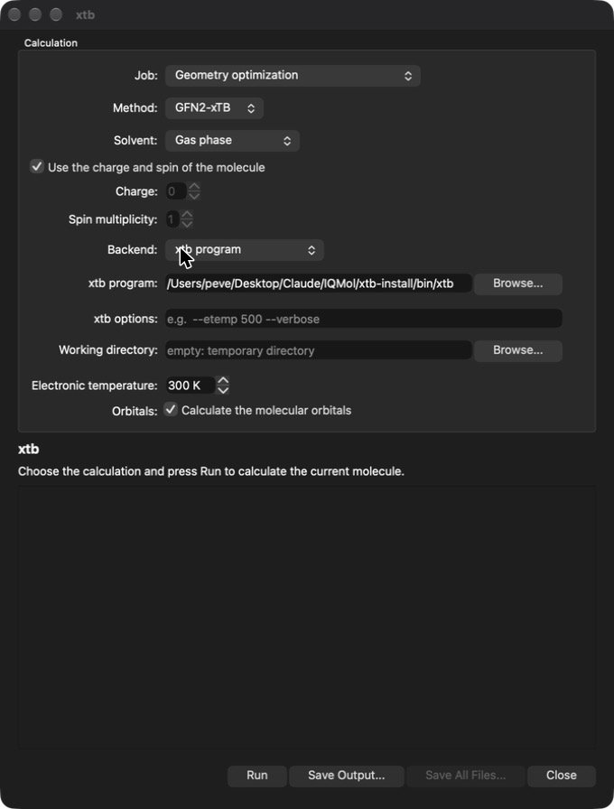

# IQMolX

IQMolX is a fork of [IQmol 3](https://github.com/nutjunkie/IQmol3), the molecular
builder and visualization package written by Andrew Gilbert.  It is called IQMolX to
tell it apart from the original program.

## How IQMolX differs from IQmol

Everything IQmol does is still there (building molecules, setting up and submitting
Q-Chem jobs, surfaces, orbitals, vibrations, ...).  IQMolX adds semiempirical
calculations with [xtb](https://github.com/grimme-lab/xtb) (Grimme group), run
from inside the program:

* **xtb window** (Calculation → xtb Setup..., or the xtb button on the tool bar) to set
  up and run GFN2-xTB and GFN1-xTB calculations: single point energies, geometry
  optimizations, vibrational frequencies and optimization plus frequencies.  Charge and
  spin multiplicity, the ALPB implicit solvents and the electronic temperature can be
  chosen, and the live xtb output and a summary of the result are shown in the window.
* **Two backends**: the built-in library (libxtb, with its own geometry optimizer; the
  default) or the external xtb program.  The program adds the electronic temperature, the
  molecular orbitals, extra command line options and a working directory, and *Save All
  Files* copies every file xtb wrote.
* **Results in the usual tools**: the optimized geometry (undoable), the vibrational
  modes and IR intensities (in the Frequencies viewer) and the molecular orbitals (in
  the orbital viewer, with the program backend) are added to the molecule.
* **GFN-FF as a force field**, next to UFF and the others in Build → Select Force Field.
* **Apple Silicon (arm64) macOS builds** with current Homebrew and Xcode:
  `build-macos.sh` and, for xtb, `build-xtb-macos.sh`.
* Smaller changes: visible check boxes in the Model View on macOS dark mode, clicking
  one of several orbital surfaces shows it alone, a readable (white) Q-Chem input
  preview in dark mode, and the def2-QZVP, def2-QZVPP, def2-QZVPD and def2-QZVPPD basis
  sets in the Q-Chem basis list.

<p align="center"></p>

The xtb help page is part of the built-in help (Help → Show Help).  The changes are on
top of IQmol 3.2.x; internally the program, its settings and its source folders keep the
name IQmol.

## How IQMolX was developed

The changes to IQmol were written by Roberto Peverati **with the help of Claude**, an AI
assistant made by Anthropic (Claude Code), which wrote most of the code, tests and
documentation under his direction.  He defined the goals, ran and checked the program, and
decided what to keep.  The work is tested (see `tests`), but it has not had the review of a
long-established project, so please report problems.  The commit messages of the AI-assisted
changes end with a `Co-Authored-By: Claude` line.

## Building

The source relies on submodules, so use the recursive flag to check out the code:

```
git clone --recursive https://github.com/peverati/IQMolX.git
```

To compile, make sure that your Qt installation can be found by cmake.  This means that
the CMAKE\_PREFIX\_PATH environment variable should include the directory containing the
Qt5Config.cmake file

```
export CMAKE_PREFIX_PATH=/directory/containing_Qt5Config.cmake
./configure
cd build
make
```

### macOS on Apple Silicon

`build-macos.sh` holds a recipe that works with Homebrew (qt@5, boost, openssl@3, libomp,
gcc; the header of the script lists the prerequisites).  To get the built-in xtb library,
first build xtb with `build-xtb-macos.sh` and give its install folder to the IQMolX build:

```
./build-xtb-macos.sh
XTB_ROOT=<xtb install dir> ./build-macos.sh
```

The external xtb program can also be any xtb 6.7 installation; its location is set in the
xtb window.  The tests of the xtb interface are in `tests`.

## Credits and license

IQmol was written by Andrew Gilbert, see <http://iqmol.org> for the original program and
pre-compiled binaries; a user guide is in the `doc` directory.  The xtb additions
are by Roberto Peverati.  IQMolX uses
[xtb](https://github.com/grimme-lab/xtb) (LGPL-3.0) and, like IQmol, is distributed under
the GNU General Public License, see `LICENSE`.
